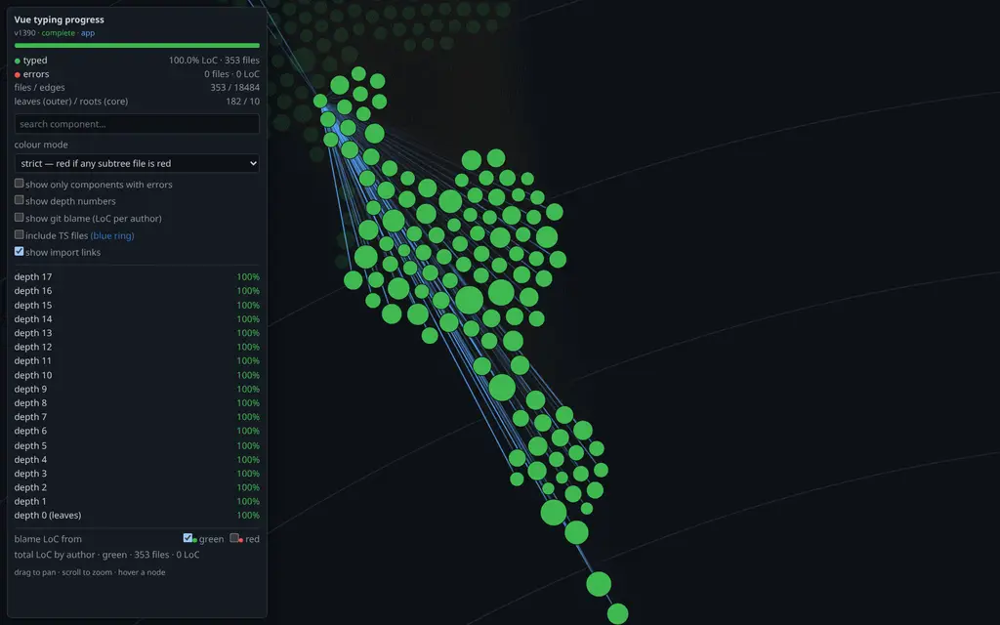
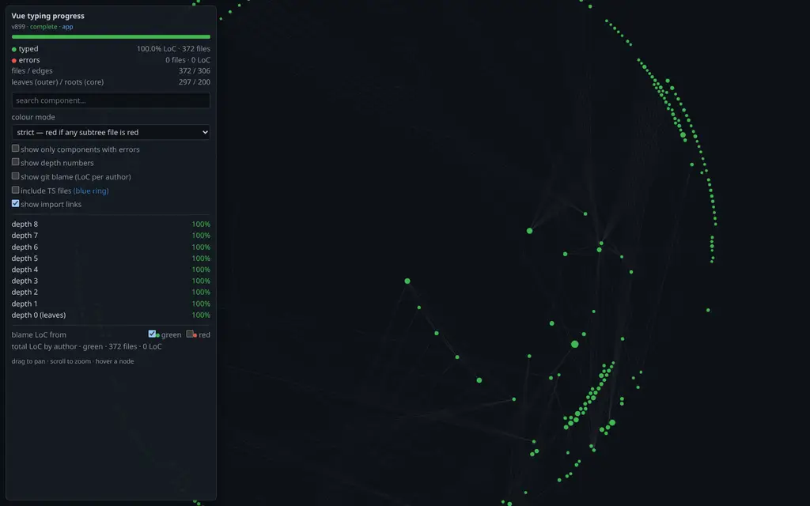

<!-- Generated by readmer from .readmer/readme.json. Edit the JSON, then run `readmer`. -->
<div align="center">

# Vite Plugin Tsmigrate

_A Vite 8 dev-tool plugin that visualises a Vue app's TypeScript migration progress as an interactive radial graph. 🗺️_

[](https://github.com/web-dev-sam/vite-plugin-tsmigrate/actions/workflows/test.yml)

</div>

&nbsp;

## Why does this exist?
Watching a JavaScript → TypeScript migration turn from red to green shows which files still block it, and how much code (and whose) each one carries.

## What it is

A **Vite 8** dev-tool plugin that visualises a Vue app's **TypeScript
migration progress**. During dev it hosts its **own Vue app** on a separate
port that crawls your component/module import graph and renders it as an
interactive WebGL radial graph — every file coloured by its `vue-tsc` type
status (green = typed, red = has or aggregates errors), sized by lines of
code, with optional per-author `git blame`. A devtool in the spirit of
vite-plugin-inspect and vue-devtools.

It also ships a **`tsmigrate` CLI** that prints the same graph as a work
list — child-first, so you type each file after the files it imports.

Scaffolded and maintained with [Vite+](https://viteplus.dev) (`vp`).

## How to install it

```bash
pnpm add -D vite-plugin-tsmigrate
# npm i -D vite-plugin-tsmigrate  ·  yarn add -D vite-plugin-tsmigrate
```

Requires `vite@^8` as a peer dependency.

## How to use it

Add the plugin to your Vite config:

```ts
// vite.config.ts
import { defineConfig } from "vite";
import { tsmigrate } from "vite-plugin-tsmigrate";

export default defineConfig({
  plugins: [tsmigrate()],
});
```

Start your dev server as usual (`pnpm dev`) and open the **tsmigrate** URL the
plugin prints next to Vite's:

```
  ➜  Local:      http://localhost:5173/
  ➜  tsmigrate:  http://localhost:7357/
```

That page renders your app's component/module import graph as an interactive
radial map, each file coloured by its `vue-tsc` type status — so you can watch a
JavaScript → TypeScript migration turn from red to green, spot the files still
blocking it, and see how much code (and whose) each one carries.

By default the plugin runs `vue-tsc` for you. Point `typeCheckCommand` at your
project's own checker (or set it to `false` to skip the type pass), and turn on
`blame` to attribute lines per author:

```ts
tsmigrate({
  typeCheckCommand: ["vue-tsc", "--noEmit", "--pretty", "false"],
  blame: true,
});
```

### Experimental: TypeScript 7.1 checker

The tool's **type check** toggle (in settings), or `experimentalTs7: true`,
replaces `typeCheckCommand` with the TypeScript 7.1 beta API. Vue's content
mapper converts `.vue` files into code TypeScript can check. One TypeScript
process stays up for the lifetime of the dev server and re-checks every file
after each change. This mode **runs external code**: TypeScript starts
`@vue/content-mapper`'s own Node process.

There is nothing extra to install. The plugin ships both previews as its own
pinned dependencies: TypeScript `7.1.0-beta` (under the npm alias
`typescript-7`, so it never replaces the TypeScript that vue-tsc uses) and
`@vue/content-mapper` `4.0.0-alpha.3`. They add about 35 MB to the install,
most of it TypeScript 7's native binary.

No config is needed: the plugin generates one that extends `tsconfig.app.json`
(or else `tsconfig.json`) and adds `noEmit`, `skipLibCheck` and the Vue mapper.
To control what gets checked, add `tsconfig.ts7-check.json` (or point
`ts7Tsconfig` at another path); the plugin then uses it as is:

```jsonc
{
  "extends": "./tsconfig.json",
  "compilerOptions": { "noEmit": true, "skipLibCheck": true },
  "contentMappers": [{ "package": "@vue/content-mapper", "extensions": [".vue"] }],
  "include": ["src/**/*.ts", "src/**/*.tsx", "src/**/*.vue"]
}
```

Put Vue compiler options in the mapper entry's `options`; the mapper ignores
`vueCompilerOptions`.

Either way, the plugin opens the config through a shim in
`node_modules/.tsmigrate/ts7/` that links both packages, because TypeScript
resolves the mapper (and the mapper resolves `typescript`) from the opened
config's folder. Relative mapper `plugins` paths therefore resolve from the
shim, so reference plugins by package name.

Failures surface in two ways:

- **A broken config or mapper** shows as a type-check error, never as all files
  passing.
- **When TypeScript 7.1 can't run at all** (crashed, no binary for the
  platform), the pass falls back to `typeCheckCommand` and the toggle shows
  why.

To read a file's error messages, call `GET /api/type-errors?id=<file>`.

## CLI: `tsmigrate depth`

A type is a contract, and a parent extends the contract of everything it
imports — so typing a parent first means guessing its children's types, then
writing them again. `tsmigrate depth` prints your files in the order that
avoids it:

```bash
npx tsmigrate depth 0     # leaves: they import nothing else in your project
npx tsmigrate depth 1     # their parents — every import already typed
```

Depth is the same measure the graph draws as concentric rings: the longest
import path from a file down to a leaf. Omit it to get the whole migration in
order, as `<depth>\t<file>`:

```bash
$ npx tsmigrate depth --untyped
0	src/util/format.js
1	src/components/Legacy.vue
2	src/views/Dashboard.vue
tsmigrate: 3 untyped of 41 files, depth 0-6, full graph, root /app
```

stdout carries nothing but paths, so it pipes straight into a todo list, a
`git add`, or a codemod:

```bash
npx tsmigrate depth 0 --untyped | sed 's/^/- [ ] /' >> TODO.md
```

| Flag               | Description                                                                                         |
| ------------------ | --------------------------------------------------------------------------------------------------- |
| `-u, --untyped`    | Only files that still need typing: the `.js` family, or an SFC whose `<script>` is not `lang="ts"`. |
| `-g, --graph <g>`  | `full` (every module) or `vue` (components only, barrel hops collapsed). Default `full`.            |
| `-j, --json`       | Emit `{ root, graph, maxDepth, files, layers, cycles }` instead — layers already ordered.           |
| `-r, --root <d>`   | Project root. Default cwd.                                                                          |
| `-c, --config <f>` | Vite config file. Default auto-detected.                                                            |

The CLI loads your Vite config (for the real resolver: aliases,
`import.meta.glob`, SFC scripts) but runs nothing else — no dev server, no
port, no `vue-tsc`, no git. vben's 719-file graph takes about a second.

One caveat it reports rather than hides: **inside an import cycle there is no
child-first order**, so those files' depth is arbitrary. Cycles are listed on
stderr (and in `--json`) — type each cycle's files together, or cut an edge
first.

## Options

| Option             | Type                     | Default                                        | Description                                                                                                                                                                                                                                           |
| ------------------ | ------------------------ | ---------------------------------------------- | ----------------------------------------------------------------------------------------------------------------------------------------------------------------------------------------------------------------------------------------------------- |
| `typeCheckCommand` | `string[] \| false`      | `["vue-tsc", "--noEmit", "--pretty", "false"]` | Command run once for the project-wide type-check whose per-file error counts colour the graph. Must emit `tsc`-style `--pretty false` diagnostics. `false` skips the pass (every file shows as typed).                                                |
| `experimentalTs7`  | `boolean`                | `false`                                        | Start with the experimental TypeScript 7.1 checker on (see above). The tool's toggle switches it at runtime. Runs external code: the content mapper's Node process.                                                                                  |
| `ts7Tsconfig`      | `string`                 | `"tsconfig.ts7-check.json"`                    | Config the TypeScript 7.1 checker opens, relative to the Vite root. When missing, one is generated from `tsconfig.app.json` / `tsconfig.json`.                                                                                                        |
| `blame`            | `boolean`                | `false`                                        | Enable per-file `git blame` (LoC per author) in the tool. Needs real commit history — a shallow clone has none.                                                                                                                                       |
| `blameAliases`     | `Record<string, string>` | `{}`                                           | Map raw `git blame` author names to canonical display names (line counts merge). Only used when `blame` is on.                                                                                                                                        |
| `toolPort`         | `number`                 | `7357`                                         | Port for the plugin's own tool server (dev only); falls back to an ephemeral port when taken.                                                                                                                                                         |
| `logOnStart`       | `boolean`                | `true`                                         | Log the tool URL when the dev server starts.                                                                                                                                                                                                          |

## How to develop it

This project uses the [Vite+](https://viteplus.dev) toolchain — a single `vp`
CLI wrapping Vite, Rolldown, Vitest, tsdown, Oxlint, and Oxfmt. The tool UI's
force layout is a Rust crate (`tool/layout`) compiled to WebAssembly, so
building needs a Rust toolchain with the `wasm32-unknown-unknown` target
(`rustup target add wasm32-unknown-unknown`).

```bash
vp install    # install dependencies (workspace: plugin + tool + playgrounds)
vp test       # run the test suite (Vitest)
vp check      # format + lint + type-check
vp run build  # layout wasm (cargo) + plugin (tsdown) + tool UI to dist/client
```

### The tool dev loop

One command runs everything you need to iterate on the tool UI or the plugin:

```bash
pnpm dev:tool   # or: node scripts/dev.mjs
```

It starts two long-lived servers and keeps them alive (restarting either if it
crashes, both torn down on Ctrl-C):

- **app** — a playground dev server (default `playground`; override with
  `TSMIGRATE_PLAYGROUND=playground-vuetify`). It loads the plugin from source,
  so the plugin serves its JSON API on `:7357`.
- **tool** — the tool UI on `http://localhost:7358` with hot reload, proxying
  `/api` to `:7357`.

Then just edit and watch:

- **Edit `tool/**`** → live HMR at `:7358`. No rebuild.
- **Edit `src/**`** → the app's Vite server auto-restarts (the config imports
  the plugin from source); the plugin reclaims `:7357` and the tool reconnects
  on its next poll. No manual restart.

`dist/client` is only the _shipped_ bundle for the no-HMR path (the plugin
serving its own prebuilt UI on `:7357`); rebuild it with `vp run build` when
you want to verify that path. VSCode users get the same via the `Dev + Tool UI
(HMR)` task in `.vscode/tasks.json`.

### Testing an unreleased build on another machine

```bash
vp run pack:local   # build + pack → .pack/vite-plugin-tsmigrate-<version>.tgz
```

Copy the tarball over and add it to the project you want to try it on:

```bash
pnpm add -D ./vite-plugin-tsmigrate-<version>.tgz   # or npm i -D …
```

The tarball carries the prebuilt tool UI and layout wasm, so that machine
needs neither Rust nor this repo. The install fetches the TypeScript 7.1
binary for that machine's platform. After copying a newer tarball, run the
same `add` again.

## Playgrounds

Three real-world targets exercise the crawl, each vendored as a git submodule
that consumes the plugin from source (`../src/index.ts`) and is analysed by
running `vp dev` in its directory.

### `playground/` — vue-vben-admin (a real app, live type-check)



_`web-antd`'s full module graph — 719 nodes / 2,177 edges, all green (fully typed), scoring **73/100**. Most of its overhead comes from widely-imported files that still change often, plus a few big branchy components; 84% of the code has real git history behind that measurement. Node size ∝ LoC; edges are import relations._

`playground/` is a **complex, real-world app**: [vue-vben-admin](https://github.com/vbenjs/vue-vben-admin)'s
`web-antd` admin — a Vue 3 + TypeScript monorepo (~700 `.vue` + ~700 `.ts`
across the app shell and its `@vben/*` / `@vben-core/*` packages) — vendored as
a git submodule under `playground/vben`. It consumes the plugin from source
(`../src/index.ts`). The entry (`src/main.ts`) imports web-antd's own entry, and
`vite.config.ts` maps vben's workspace aliases (`#/*`, `@vben/*`, `@vben-core/*`)
to package **source**, so the tsmigrate crawl fans out across the real module
graph without a monorepo build.

```bash
git submodule update --init --depth 1 playground/vben   # fetch vben
cd playground/vben && pnpm install                       # deps for the type-check pass
cd .. && vp dev   # dev server — the tsmigrate tool URL is appended to Vite's output
```

Notes specific to this playground:

- **The type-check is real**: `typeCheckCommand` runs vben's own `vue-tsc` over
  the `web-antd` app, and the per-file error counts drive node coloring. A clean
  vben checkout is fully typed, so every node reads green (`100% typed`) —
  introduce a type error in `vben/apps/web-antd/src` to watch a node, and its
  importers, turn red. The pass needs the submodule's `node_modules` (the
  `pnpm install` above); without them the tool surfaces a type-check error and
  nodes fall back to green.
- **The analyzer is Vue-version-agnostic** — Vue 2 and Vue 3 alike. It reads SFC
  `<script>` blocks and import specifiers statically and never compiles
  components, so the Vue version is irrelevant to the crawl.
- **git blame is unavailable here**: a shallow submodule has no line history to
  attribute, so the author rollup is empty. Blame is exercised by the tests.

### `playground-vuetify/` — Vuetify (a component library)


_`packages/vuetify/src` — 524 TypeScript modules (blue TS rings), a fully-migrated component library scoring **60/100**. Hovering `helpers.ts` shows why: 863 lines that 200 modules consume — when it changes (and git history says it does), 88% of the library needs re-checking._

`playground-vuetify/` vendors the **Vuetify monorepo itself**
([`vuetifyjs/vuetify`](https://github.com/vuetifyjs/vuetify)) as a git submodule
under `playground-vuetify/vuetify`. Unlike vben (an app), this is a component
_library_: the crawl seeds from Vuetify's own bundler entry and fans out across
**~520 modules** — every component (`.tsx`), composable, directive and blueprint
under `packages/vuetify/src`, resolved to source via the `@/` alias (no Vuetify
build required).

```bash
git submodule update --init --depth 1 playground-vuetify/vuetify   # fetch Vuetify
cd playground-vuetify/vuetify && pnpm install                       # deps for the type-check
cd .. && vp dev   # dev server — the tsmigrate tool URL is appended to Vite's output
```

Notes specific to this playground:

- **It's `.tsx`, not `.vue`**: Vuetify authors components as `.tsx`, so the
  component graph lives in the module (TS) view — the tool auto-selects "include
  TS files" when a project has no `.vue` nodes. Blue rings mark TS modules.
- **The type-check is real** — it runs Vuetify's own `vue-tsc` over
  `packages/vuetify` (install the submodule's deps first: `cd
playground-vuetify/vuetify && pnpm install`). Vuetify's committed ambient
  `.d.ts` shim sass and build globals like `__VUETIFY_VERSION__`, so the pass is
  accurate, not spurious. Vuetify is **fully migrated to TypeScript**, so a
  clean checkout reports zero errors → every node is green. Introduce a type
  error in a `packages/vuetify/src` module to watch it — and every module that
  imports it — turn red (a bad type in a foundational composable reddens 100+
  nodes). To visualise an _in-progress_ migration (red turning green as code is
  typed), point the type-check at a codebase that still has untyped modules.

### `playground-shadcn/` — shadcn-vue (a component registry)



_The shadcn-vue registry — 448 components that barely import each other, sitting on the outer (leaf) rim of the radial layout and scoring **98/100**: changes stay local, and every depth row is 100% typed._

`playground-shadcn/` vendors the **shadcn-vue monorepo**
([`unovue/shadcn-vue`](https://github.com/unovue/shadcn-vue)) as a git submodule
under `playground-shadcn/shadcn-vue`. The analysed codebase is its component
registry (`apps/v4/registry/new-york-v4`): the entry imports all **66 UI
component barrels**, so the crawl fans out across **~370 `.vue` components** plus
their shared `.ts` helpers (~450 nodes / ~880 edges), resolved to source via
shadcn-vue's `@/` alias (no build required).

```bash
git submodule update --init --depth 1 playground-shadcn/shadcn-vue   # fetch shadcn-vue
cd playground-shadcn && vp dev   # dev server — the tsmigrate tool URL is appended to Vite's output
```

Note: shadcn-vue's registry is a Nuxt app whose type-check relies on Nuxt's
generated tsconfig and auto-imports, so a standalone `vue-tsc` isn't wired here;
the type pass is left off and the crawl maps the real component graph + LoC.
The vben and Vuetify playgrounds run a live `vue-tsc` pass.

During dev the plugin hosts **its own Vue app** — the tool UI in `tool/`,
prebuilt into `dist/client` and shipped with the package — on a separate port,
unrelated to the app server. The tool analyses the user's app and shows every
component with its file path, LoC, and git blame (lines per author), plus the
component import graph rendered as a WebGL radial view. Data flows over a small
JSON API: `GET /api/graph` (progressive results while analyzers run; cheap
`?since=<version>` probes once complete), `GET /api/type-errors?id=<file>`
(one file's type-error messages) and `GET /api/diagnostics`. Its URL is
appended to Vite's block, styled exactly like Vite's output (green `➜`, cyan
URL, via picocolors — Vite's own color lib):

```
  ➜  Local:   http://localhost:5173/
  ➜  tsmigrate: http://localhost:7357/
```

The tool shuts down with the dev server. To iterate on `tool/` with hot reload
(no rebuild), use `pnpm dev:tool` — see [The tool dev loop](#the-tool-dev-loop).
VSCode users: run the `Dev + Tool UI (HMR)` task from `.vscode/tasks.json`.

## License

[MIT](./LICENSE)
